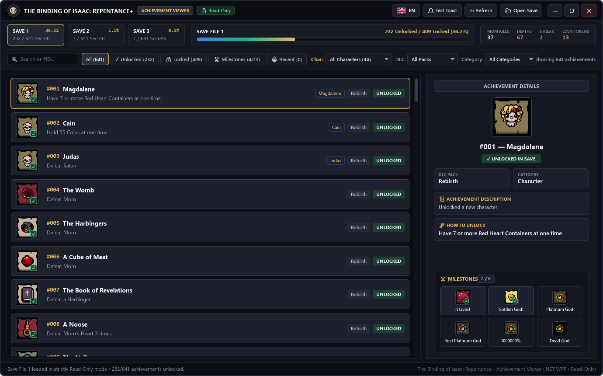

<div align="center">

# 🩸 The Binding of Isaac: Repentance+ — Achievement & Secret Viewer

### 🌐 Choose Language / Dil Seçimi

[-b83228?style=for-the-badge)](README.md)
[-2b1d16?style=for-the-badge)](README.tr.md)

<p>
  <a href="README.md"><b>🇬🇧 English</b></a> •
  <a href="README.tr.md"><b>🇹🇷 Türkçe</b></a>
</p>

---



**A strictly Read-Only Achievement & Save File Viewer for *The Binding of Isaac: Repentance+*, built with .NET (WPF) and styled after the game's dark cellar & pinned parchment aesthetic.**

</div>

---

## ✨ Key Features

- 🔒 **100% Strictly Read-Only Save Protection:**
  - Opens save files exclusively at the OS kernel level using `FileMode.Open`, `FileAccess.Read`, and `FileShare.ReadWrite`.
  - **Cannot modify, overwrite, or corrupt** your save files under any circumstances, and never locks the file while the game is running.
- 📂 **Automatic Save Detection & Real-Time Sync:**
  - Automatically scans and loads all 3 save slots (`Slot 1`, `Slot 2`, `Slot 3`) from Steam Cloud (`Steam\userdata\<id>\250900\remote\rep+persistentgamedata1..3.dat`) and `Documents\My Games\Binding of Isaac Repentance+`.
  - Uses a live `FileSystemWatcher` to automatically update your unlocked achievements in real time while you play.
- 🏆 **All 641 Official Achievements & Game Artwork:**
  - Covers every DLC era: *Rebirth (1–178)*, *Afterbirth (179–276)*, *Afterbirth+ (277–403)*, *Repentance (404–637)*, and *Repentance+ (638–641)* (including Online & *Item Descriptions* achievements).
  - Uses the official pixel-art achievement icons from the game.
  - Displays a custom **padlock & chain overlay** directly on top of locked achievement icons.
- 👤 **34 Playable Characters (Normal + Tainted) Progress Tracker:**
  - Filter achievements by any of the **17 Normal** or **17 Tainted** characters and view live completion counters per character (e.g., `Isaac (9/15)`, `Azazel (17/17 ✓)`).
- 🔔 **Live Bottom-Right Unlock Toast Notification & Session History:**
  - When you unlock a new secret while playing, a non-intrusive **bottom-right desktop toast notification (`UnlockToastWindow`)** slides in without stealing game focus, stays for 5 seconds, and fades out automatically.
  - Newly unlocked secrets are highlighted with a **`🔥 NEW`** badge and listed under the **`🔥 Recent`** tab.
- 📜 **Detailed Unlock Guide ("SECRET FOUND!" Panel & Milestone Trophy Cabinet):**
  - Displays the in-game description, clear **How to Unlock** conditions (in both English and Turkish), and a 3×2 **Milestone Trophy Cabinet** (*It Lives!, Golden God!, Platinum God, Real Platinum God, 1000000%, Dead God*).
- 📊 **Live In-Game Save Statistics:**
  - Displays real-time counters from your save file: *Mom Kills, Deaths, Win Streak, Best Streak, Donation Machine Coins, Greed Machine Coins, Eden Tokens, Collectibles Seen,* and *Challenges Completed*.
- 🎨 **Custom Isaac-Themed UI:**
  - Custom borderless title bar (drag, minimize, maximize, close), custom dark cellar & aged-bronze scrollbar, and instant search/filter by Unlock Status, Character, DLC, Category, or `#ID`.

---

## 🚀 Getting Started

### Option 1: Download from GitHub Releases (Recommended — Single-File `.exe`)
You don't need to clone the repository or keep external `Data`/`Assets` folders next to the app. Simply download one of the portable single-file executables from the [**GitHub Releases**](https://github.com/ToprakEsen/The-Binding-of-Isaac-Repentance-Achievement-Viewer/releases/latest) page and run it directly:

| Download Package | Size | Description |
| :--- | :---: | :--- |
| [**`IsaacAchievementViewer-v1.4.1-Standalone.exe`**](https://github.com/ToprakEsen/The-Binding-of-Isaac-Repentance-Achievement-Viewer/releases/download/v1.4.1/IsaacAchievementViewer-v1.4.1-Standalone.exe) | ~70 MB | **No `.NET` required.** Fully self-contained single-file executable with the .NET 8 runtime and all 641 achievement icons embedded inside. |
| [**`IsaacAchievementViewer-v1.4.1-Non-Standalone.exe`**](https://github.com/ToprakEsen/The-Binding-of-Isaac-Repentance-Achievement-Viewer/releases/download/v1.4.1/IsaacAchievementViewer-v1.4.1-Non-Standalone.exe) | ~2 MB | **Lightweight version (Non-Standalone).** Uses Windows' built-in `.NET Framework 4.8` with all 641 achievement icons and database embedded inside a single `.exe`. |

### Option 2: Build from Source
If you want to compile the project from source on Windows using the built-in `.NET Framework MSBuild`:

```powershell
& "C:\Windows\Microsoft.NET\Framework64\v4.0.30319\MSBuild.exe" "IsaacRepentancePlusAchievements.csproj" /p:Configuration=Release
```

---

## 📁 Project Structure

| File / Folder | Description |
| :--- | :--- |
| `MainWindow.xaml` / `.cs` | Custom borderless title bar, cellar/parchment UI layout, search & filtering |
| `App.xaml` | Custom Isaac-themed `ScrollBar` and `ComboBox` control templates |
| `Services/ReadOnlySaveReader.cs` | Strictly read-only (`FileAccess.Read`) binary parser for `ISAACNGSAVE09R` `.dat` files |
| `Models/` | `AchievementItem` and `SaveSlotData` data models |
| `Data/achievements.json` | Complete database of all 641 achievements with EN & TR descriptions and unlock guides |
| `Assets/Achievements/` | Official pixel-art icons (`1.jpg` – `641.jpg`) for all 641 achievements |
