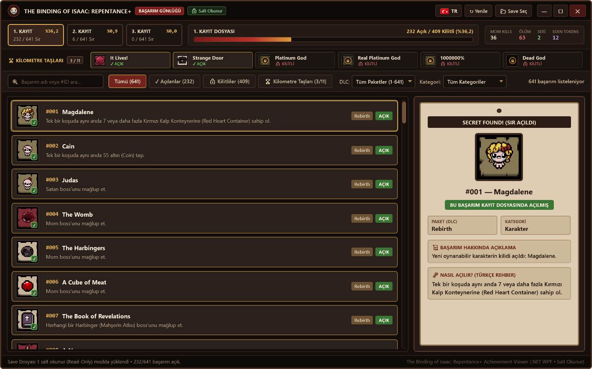

<div align="center">

# 🩸 The Binding of Isaac: Repentance+ — Başarım & Sır Günlüğü

### 🌐 Dil Seçimi / Choose Language

[-2b1d16?style=for-the-badge)](README.md)
[-b83228?style=for-the-badge)](README.tr.md)

<p>
  <a href="README.md"><b>🇬🇧 English</b></a> •
  <a href="README.tr.md"><b>🇹🇷 Türkçe</b></a>
</p>

---



**The Binding of Isaac: Repentance+ için geliştirilmiş, `.NET (WPF)` tabanlı, oyunun karanlık mahzen ve parşömen temasına sadık, %100 Salt Okunur (Read-Only) başarım ve kayıt dosyası görüntüleme uygulaması.**

</div>

---

## ✨ Öne Çıkan Özellikler

- 🔒 **%100 Salt Okunur (Read-Only) Koruma:**
  - Kayıt dosyalarını işletim sistemi düzeyinde yalnızca `FileMode.Open`, `FileAccess.Read` ve `FileShare.ReadWrite` izinleriyle açar.
  - Kayıt dosyalarınızı **kesinlikle düzenlemez, üzerine yazmaz, bozmaz** ve oyun açıkken oyunun kayıt almasını engellemez.
- 📂 **Otomatik Save Algılama & Canlı Senkronizasyon:**
  - Steam Cloud (`Steam\userdata\<id>\250900\remote\rep+persistentgamedata1..3.dat`) ve `Belgelerim\My Games\Binding of Isaac Repentance+` klasörlerindeki 3 kayıt yuvasını (`1. Kayıt`, `2. Kayıt`, `3. Kayıt`) otomatik bulur.
  - Siz oyunu oynarken yeni bir başarım açtığınızda `FileSystemWatcher` ile pencereyi kapatmaya gerek kalmadan anında canlı olarak güncellenir.
- 🏆 **641 Resmi Başarım & Oyun İçi Görseller:**
  - *Rebirth (1–178)*, *Afterbirth (179–276)*, *Afterbirth+ (277–403)*, *Repentance (404–637)* ve *Repentance+ (638–641)* (yeni Online ve *Item Descriptions* başarımları dahil) tüm **641 başarımın** orijinal piksel-art görsellerini içerir.
  - Kilitli olan başarımların görselleri üzerinde özel **kilit ve zincir simgesi katmanı** yer alır.
- 📜 **Detaylı "Nasıl Açılır?" Rehberi (*SECRET FOUND!* Parşömen Kağıdı):**
  - Seçilen başarımın oyun içi açıklaması ve nasıl açılacağını anlatan detaylı **Türkçe ve İngilizce** koşul rehberi sağdaki parşömen kağıdında gösterilir.
- 📊 **Canlı Kayıt İstatistikleri:**
  - Kayıt dosyasından gerçek zamanlı olarak *Mom Kills (Anne Öldürme), Ölüm Sayısı (Deaths), Kazanma Serisi (Streak), Bağış ve Greed Makinesi, Eden Token, Keşfedilen Eşya* ve *Tamamlanan Challenge* sayılarını çeker.
- 🎨 **Özel Isaac Temalı Arayüz & Başlık Çubuğu:**
  - Kendine özel açma/kapama/küçültme barı, özel mahzen/bronz kaydırma çubuğu (`ScrollBar`) ve Durum / DLC / Kategori / `#ID` filtreleme sistemi.

---

## 🚀 Kurulum ve Çalıştırma

### Seçenek 1: GitHub Releases Üzerinden İndirme (Önerilen — Tek Dosya `.exe`)
Depoyu klonlamanıza veya yanına `Data` / `Assets` klasörleri koymanıza gerek yoktur. Doğrudan [**GitHub Releases**](https://github.com/ToprakEsen/The-Binding-of-Isaac-Repentance-Achievement-Viewer/releases/latest) sayfasından ihtiyacınıza uygun tek dosyalık `.exe` sürümünü indirip çalıştırabilirsiniz:

| İndirme Seçeneği | Boyut | Açıklama |
| :--- | :---: | :--- |
| [**`IsaacAchievementViewer-v1.3.0-Standalone.exe`**](https://github.com/ToprakEsen/The-Binding-of-Isaac-Repentance-Achievement-Viewer/releases/download/v1.3.0/IsaacAchievementViewer-v1.3.0-Standalone.exe) | ~70 MB | **`.NET` kurulumu gerektirmez.** `.NET 8` çalışma zamanı ve 641 başarım görseli tek bir `.exe` içine gömülüdür; her bilgisayarda doğrudan çalışır. |
| [**`IsaacAchievementViewer-v1.3.0-Duz.exe`**](https://github.com/ToprakEsen/The-Binding-of-Isaac-Repentance-Achievement-Viewer/releases/download/v1.3.0/IsaacAchievementViewer-v1.3.0-Duz.exe) | ~2 MB | **Hafif sürüm.** Windows'ta yerleşik bulunan `.NET Framework 4.8` altyapısını kullanır; 641 başarım görseli ve veritabanı yine tek `.exe` içine gömülüdür. |

### Seçenek 2: Kaynak Koddan Derleme
Projeyi kaynak koddan derlemek isterseniz Windows üzerindeki yerleşik `.NET Framework MSBuild` ile derleyebilirsiniz:

```powershell
& "C:\Windows\Microsoft.NET\Framework64\v4.0.30319\MSBuild.exe" "IsaacRepentancePlusAchievements.csproj" /p:Configuration=Release
```

---

## 📁 Proje Yapısı

| Dosya / Klasör | Açıklama |
| :--- | :--- |
| `MainWindow.xaml` / `.cs` | Özel başlık çubuğu, mahzen/parşömen arayüzü, arama ve filtreleme |
| `App.xaml` | Özel Isaac temalı `ScrollBar` ve `ComboBox` kontrol şablonları |
| `Services/ReadOnlySaveReader.cs` | Salt okunur (`FileAccess.Read`) `ISAACNGSAVE09R` `.dat` kayıt dosyası okuyucu |
| `Models/` | `AchievementItem` ve `SaveSlotData` veri modelleri |
| `Data/achievements.json` | 641 başarımın Türkçe ve İngilizce açıklama / kilit açma veritabanı |
| `Assets/Achievements/` | 641 başarımın orijinal oyun içi piksel-art görselleri (`1.jpg` – `641.jpg`) |
